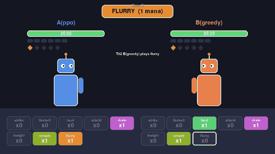
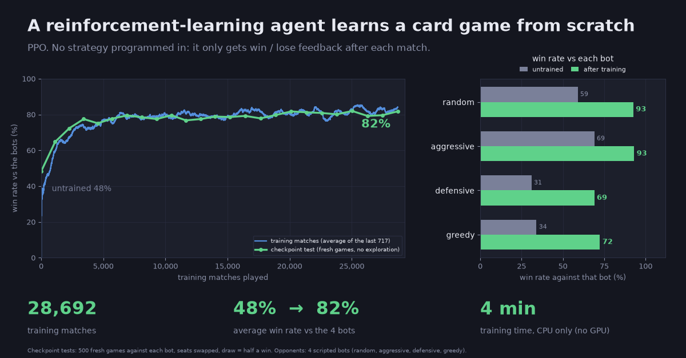
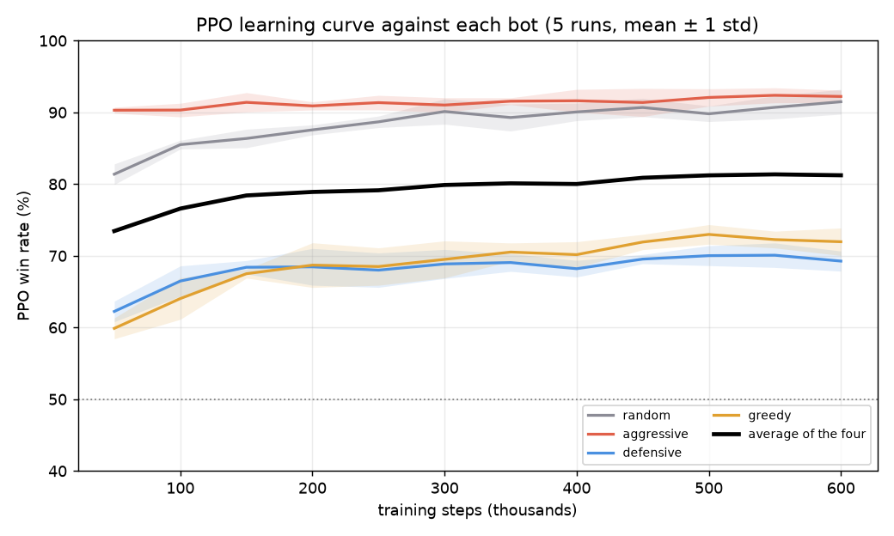
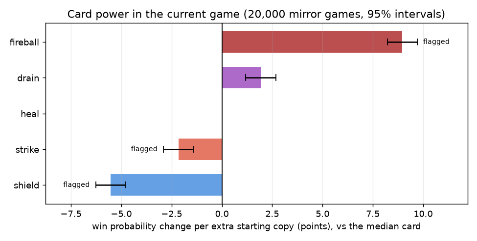
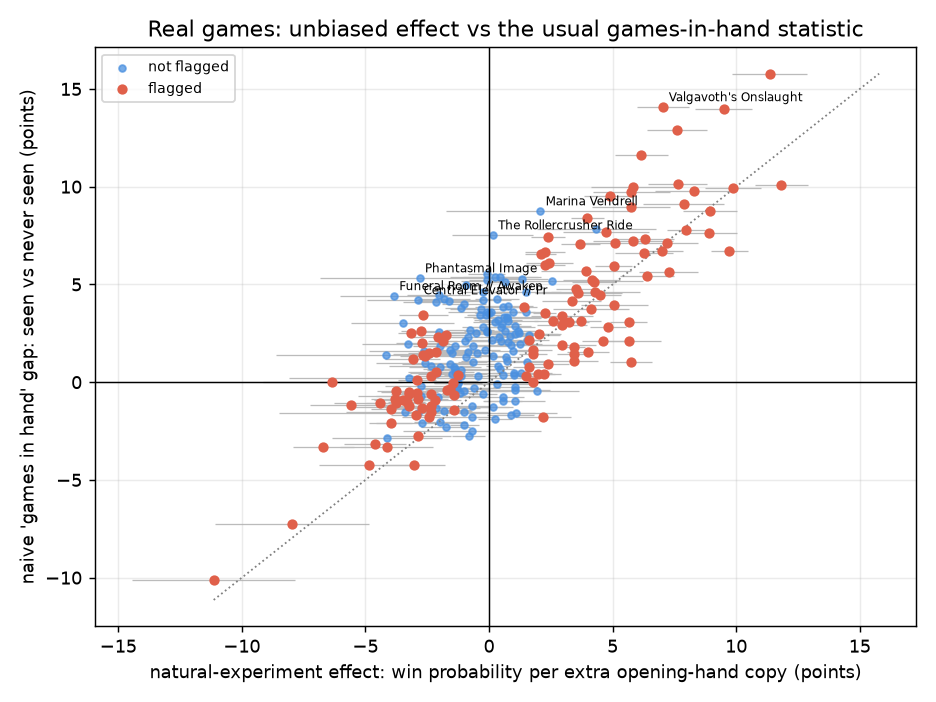
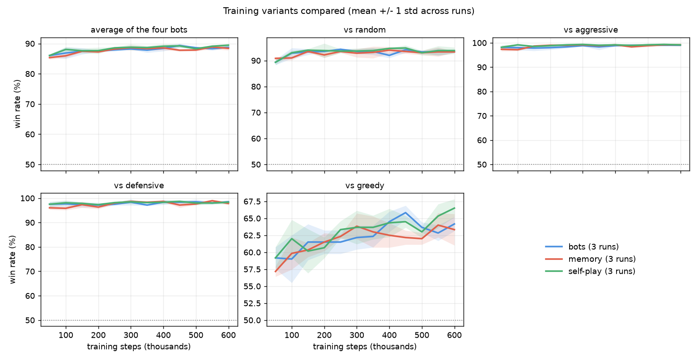

# Card Balance Game

A turn-based card duel, built from scratch, together with the tools to study it: hand-coded bots, reinforcement-learning agents (PPO), and a statistical **balance-testing tool** that estimates which cards are too strong or too weak, checks its own accuracy, and was applied to a real game's data (Magic: The Gathering draft logs).


*The original game: a trained PPO agent (left) beats the greedy bot on turn 21.*



*The extended card set (draw, poison and combo cards): a trained agent beats the greedy bot on turn 9. Poison counters show under the mana bar.*

**Status: v0.2.** v0.1 (engine, bots, tournaments, PPO, the card-power estimator and its validation, replay viewer) plus: a real-data check, a finer balancing search, three new card mechanics, finite decks, a deck metagame analysis, opponent-card memory and self-play. **Several of the new results are negative or inconclusive, and the README says so.**

## Watch an agent learn (match 1 to match N)

`python -m manaduel.cli story` trains an agent from scratch, records **every training match**, tests the agent at regular checkpoints on the same fresh games, and draws shareable pictures from the saved numbers (nothing is typed in by hand). One real run ([`docs/story/`](docs/story)): 28,692 training matches, 259 seconds of CPU training, no GPU.



| Average win rate vs the four bots | Before training (match 0) | After 28,692 matches |
|---|---|---|
| overall | 48% | **82%** |
| random / aggressive | 59% / 69% | 93% / 93% |
| defensive / greedy | 31% / 34% | 69% / 72% |

What changed in its play, measured on the test games: it plays Shield 2.8x as often (0.9 to 2.4 times per game) and finishes games with an average HP lead of +8.8 instead of -1.5; game length did not change (about 21 turns). Most of the learning happens in the first ~3,000 matches, then the curve flattens at about 80%.

- Animated curve and win rates growing from match 1: [`learning_animation.gif`](docs/story/learning_animation.gif)
- The untrained and the trained agent in the same game against the same bot: [`before_after.gif`](docs/story/before_after.gif) (a chosen example; the table above is the honest summary)
- Which cards it plays before and after: [`behaviour.png`](docs/story/behaviour.png); a draft caption using the real numbers: [`linkedin_post.md`](docs/story/linkedin_post.md)
- Raw data: [`matches.csv`](docs/story/matches.csv) (one row per training match) and [`checkpoints.csv`](docs/story/checkpoints.csv)

Two curves, not one: the blue line is the results of the matches the agent *trained on* (against a random mix of bots, while still exploring); the green line is the finished policy tested on the same fresh games at each checkpoint, so differences come from the agent alone. The match-0 baseline uses 100 test games per bot and the final point 500, so the starting numbers are noisier. One run, one seed: it shows that learning happened, not how reliably a fresh run lands on 82% (the five-seed results below show a spread of about one point between runs of the same recipe).

```powershell
python -m manaduel.cli story                                  # train + record + draw (about 10 minutes)
python -m manaduel.cli story --steps 100000 --out docs/quick  # a quick version
python -m manaduel.cli story --render-only --footer "your link"   # redraw from an existing recording
```

## The game

Two players start at 20 HP and alternate turns.

- **Mana:** at the start of your own turn it refills to `min(your turn number, 5)`. Unspent mana is lost.
- **Hand:** you start with 3 random cards and draw 1 at the start of each turn (the first player skips the draw on turn 1). The hand limit is 6; extra cards are burned. Draws are random with replacement, weighted by each card's `weight`.
- **On your turn** you may play any number of held, affordable cards, then end the turn.
- **Shield** absorbs damage before HP, is capped at 6, and expires at the start of its owner's next turn.
- You win by reducing the opponent to 0 HP. If both players are alive after turn 40, it is a draw.

| Card | Cost | Effect |
|---|---|---|
| Strike | 1 | Deal 3 damage |
| Fireball | 3 | Deal 7 damage |
| Heal | 2 | Restore 4 HP (max 20) |
| Shield | 1 | Gain 3 shield |
| Drain | 3 | Deal 3 damage and restore 3 HP |

**Extended set** ([`configs/cards_extended.yaml`](configs/cards_extended.yaml)) adds three cards that use new mechanics: **Insight** (cost 2, draw 2 cards), **Venom** (cost 2, add 3 poison: at the start of the victim's turn they lose HP equal to their poison, ignoring shield, and it drops by 1), **Flurry** (cost 1, 2 damage, +3 if another card was already played this turn).

**Deck mode** ([`configs/cards_decks.yaml`](configs/cards_decks.yaml)): each player brings a finite 20-card deck, drawn without replacement; drawing from an empty deck costs 1, then 2, then 3... HP (fatigue).

All stats and rules live in YAML files, so a balance change is a one-line edit. The new mechanics are off by default: **200 recorded v0.1 games are replayed in a test and must stay identical** (they do).

## Results

All numbers come from the code in this repo; raw outputs are in [`docs/results/`](docs/results). A draw counts as half a win. "Std" is the spread across independently trained models, not across games.

### 1. PPO beats all four hand-written bots (original game, 5 seeds)

Five PPO models (600,000 steps each) evaluated on the same fresh games, 500 per bot:

| PPO win rate vs | mean of 5 models | std |
|---|---|---|
| random | 94.4% | 1.0 |
| aggressive | 92.1% | 0.9 |
| defensive | 71.4% | 0.8 |
| greedy | 73.5% | 1.7 |



### 2. Which cards are too strong or too weak? (original game)

The estimator uses the random deal as a natural experiment (see [Method](#method)). In 20,000 mirror games of the greedy bot, one extra *starting* copy of each card changes win probability, relative to the median card, by: **Fireball +9.0, Drain +1.9, Strike −2.2, Shield −5.5** (95% intervals about ±0.8).



**Is that just how the bots play?** No: the same measurement using the trained PPO agents (8,000 games each, three models, [files](docs/results/effects_ppo_base_seed0.txt)) gives Fireball +8.5 to +9.6, Strike −0.8 to −1.8, Shield −3.6 to −5.2. Learned agents trained to win agree with the bots, so Shield's weakness looks like a property of the cards. (The first player's win rate with identical hands came out at 52.3%, 52.9% and 42.8% for the three models: that quantity is sensitive to the agent.)

### 3. Does the tool work? Planted-change validation

Known changes were planted on each card (+1, +2, +4, −1, −2 on its main stat, two repeats) and the tool asked to find them:

| | Result |
|---|---|
| Planted change detected | **44 / 50 (88%, 95% interval 76-94%)** |
| ...attributed to the right card | 37 / 50 |
| Excluding Shield | detected 39 / 40 |
| False alarms with nothing planted | 0 / 20 comparisons |


It sees changes as small as +14%. **Shield is where it fails** (5 / 10): making Shield stronger barely changes win probability, which is consistent with result 2 (a real property of the card, not only a blind spot). Limits: one bot, two repeats, smallest change tested 14%.

### 4. A real game: the same idea on 17Lands Magic: The Gathering data

The estimator was adapted to **896,877 real no-mulligan games** (set DSK, Premier Draft, 266 cards; data from [17Lands](https://www.17lands.com/public_datasets), CC BY 4.0, not included in this repo). Players choose their decks, but the opening hand is a random draw from the deck, so what is random is how many *more* copies of a card landed in the opening hand than the deck predicts. The effect is the change in win probability per extra opening-hand copy, relative to a basic land. Standard errors use a jackknife over groups of drafts.



| Check | Result |
|---|---|
| Replication: two random halves of the drafts | correlation of the two halves' effects **0.92**; 129 cards clearly non-zero in both halves, **all 129 with the same sign** |
| Sanity: on-the-play effect from the regression | **+5.1** points vs **+5.0** raw play/draw difference in the data |
| Cards flagged (Bonferroni, at least 1 point) | 73 strong, 51 weak of 266 |
| Strongest / weakest card | Zimone, All-Questioning +11.8 [10.7, 12.9]; Dazzling Theater // Prop Room −11.1 [−14.4, −7.8] |
| Agreement with the "games in hand" style statistic (seen vs never seen) | correlation 0.77 (rank 0.66), same sign for 68% of cards |

For the 69 cards whose effect is under 1 point, the "seen" statistic still shows a median gap of **+2.3 points**, an offset that fits the idea that longer games draw more cards and winners play longer games. **But the two statistics measure different things** (a card in the opening hand versus a card seen at any time, which values late-game cards differently), so their disagreement is not proof that either is wrong.

Honest framing: 17Lands already publishes opening-hand and games-in-hand statistics, so this is a **replication of known measures** with a careful uncertainty estimate and a replication test, not a new discovery. It has no ground truth for "true" card strength, effects hold for the kind of player who put the card in a deck, and it is one set. It does not test the bot-based results above on humans.

### 5. Automatic balancing, second attempt: better, still not balanced

v0.1's search only moved stats by whole numbers and gave up quickly. v0.2's `tune` command works on a doubled-resolution copy of the same game (a test checks it plays identically), can change every effect, every cost and three rules, searches coarse-to-fine, and minimises a combined objective (card power spread, excess draw rate, first-player advantage) averaged over two bots. It tested 314 configurations and made 9 changes. Checked on **new** deals (20,000 games per bot):

| | Draws | First player wins* | Cards flagged |
|---|---|---|---|
| Greedy bot, before | 22.3% | 46.1% | Strike −2.4, Fireball +8.2, Shield −6.0 |
| Greedy bot, after | 11.3% | 48.1% | Strike +3.6, Drain +2.9, Shield −6.1 |
| Defensive bot, before | 28.1% | 46.3% | Strike −3.0, Fireball +8.2, Shield −6.1 |
| Defensive bot, after | 15.3% | 48.6% | Strike +4.8, Heal −2.5, Shield −5.8 |

\*with identical hands. **What improved:** draws roughly halved, the first-player edge shrank, and Fireball stopped being an outlier. **What did not:** the number of flagged cards stayed at three; Strike overshot, and **Shield stayed at about −6**. The search never fixed Shield: it raised Shield's effect only from 6 to 7 (doubled units) and, strangely, made it *more* expensive (cost 1 to 3), because those moves helped the draw-rate and first-player terms of the objective, which Shield's own power did not outweigh. The search both tuned and was checked with the same two bots (on new deals).

**Independent check with learned agents.** Three PPO models were trained on the tuned game (600,000 steps each) and card power measured with them (8,000 mirror games each, [files](docs/results/effects_ppo_balanced_seed0.txt)): **Strike +4.2 to +5.3 and Drain +4.7 to +5.3 (too strong), Shield −5.6 to −8.0 (too weak), flagged in all three models**; Heal is fine. The first player's win rate with identical hands is **48.0%, 50.3%, 49.1%**, close to fair. So with learned agents too, the first-player edge is fixed but the card imbalance is not (and Shield looks slightly worse than with the bots).

Details: [`tune_greedy_defensive.txt`](docs/results/tune_greedy_defensive.txt); resulting config [`cards_fine_balanced.yaml`](configs/cards_fine_balanced.yaml) (numbers are in doubled units, so HP is 40).

### 6. New mechanics, opponent memory and self-play (extended card set)

Nine PPO models: three seeds each of **bots-only** (the v0.1 recipe), **+ opponent-card memory** (the agent also sees how many copies of each card the opponent has played), and **+ self-play** (a frozen copy of the agent is added to the opponent pool after every evaluation, the last four are kept). 600,000 steps each; evaluated on the same fresh games (500 per bot) and then model against model (400 games per pairing of two models).

| Win rate vs | random | aggressive | defensive | greedy | mean |
|---|---|---|---|---|---|
| bots-only (3 models) | 94.5% | 98.1% | 96.5% | 64.3% | 88.4% |
| + memory | 94.1% | 97.8% | 96.2% | 63.8% | 88.0% |
| + self-play | 95.5% | 98.0% | 96.5% | 65.0% | 88.8% |



| Model against model (9 pairings of 3 vs 3 models) | Row model wins | Std across pairs | Row model ahead in |
|---|---|---|---|
| bots-only vs bots-only, other seeds (**control**) | 50.0% | 1.6 | 3 of 9 |
| with memory vs bots-only | 48.2% | 1.0 | 0 of 9 |
| self-play vs bots-only | 51.2% | 1.8 | 6 of 9 |
| self-play vs with memory | 53.4% | 2.2 | 9 of 9 |

How to read it, honestly:
- **Memory did not help**, and was slightly worse head to head (48.2%, behind in all 9 pairings, while the control varies by about ±1.6). With three models per group this is suggestive, not proof. A plausible reason (not tested): with endless random draws, the opponent's played cards say little about their hand, and the extra inputs may only slow learning. In deck mode, where played cards narrow down the remaining deck, memory could matter; that was not trained.
- **Self-play's advantage (51.2% vs the 50.0% control) is smaller than the seed-to-seed spread**, so it is not established. It beat the memory models in all 9 pairings, but those models also carry memory's penalty.
- Against the hardest bot (greedy) the agents win only about 64%, down from 73% in the original game, while crushing the other three: the new cards are not balanced against each other (result 7).

### 7. Deck building and the metagame (deck mode, greedy bot)

Eight decks (four archetypes plus four random ones), 2,000 games per pairing:


- **The metagame is degenerate:** the *aggro* deck beats the average other deck 82.3% of the time; the equilibrium mix puts 100% on it; there are **no** rock-paper-scissors cycles; the *control* deck (heals, shields, no real damage) loses every single game.
- **Card power in deck context** (random decks given to both players, a second natural experiment): per extra copy in a 20-card deck Venom is **+6.1**, Fireball +3.9, Flurry +2.6, Shield −2.9; per extra copy in the *opening hand* Venom is **+15.5**. The two measures correlate 0.86. Venom is by far the strongest card; the new set was not tuned.
- **Deck builder** (hill climbing from the balanced deck against the 8-deck field, 300 games per matchup): average win rate against the field went from 49.6% to **75.2%** on new games, but the field included decks it was built against, and aggro still beats the built deck 56.2% of the time. This shows the metagame is easy to exploit, not that the builder is a strong deck designer.

Details: [`metagame_decks.txt`](docs/results/metagame_decks.txt).

### 8. Other findings

- **Pure aggression is a bad strategy.** The aggressive bot plays only damage cards, so heals and shields clog its hand until the hand limit burns new damage cards. Its Elo is below random.
- **Deterministic bots give fake precision.** In the first, deterministic version, 1,000 games between heuristic bots were really two distinct games repeated. Random draws, seat-swapped game pairs and shared deal seeds fixed this.
- **First-player advantage had to be tuned** with the `sweep` command: giving the second player an extra card gave the first mover 32-35%, none gave 41-43%, one fewer gave 59-60%.

## Run it

Requires Python 3.10+. On Windows PowerShell:

```powershell
python -m venv .venv
.\.venv\Scripts\python.exe -m pip install torch --index-url https://download.pytorch.org/whl/cpu
.\.venv\Scripts\python.exe -m pip install -r requirements.txt
.\.venv\Scripts\python.exe -m pip install -e .
.\.venv\Scripts\python.exe -m pytest -q
```

(`torch` is only needed for training and the PPO tests, which skip without it.)

```powershell
# play and watch games (add --config configs/cards_extended.yaml for the new cards)
python -m manaduel.cli watch --a greedy --b defensive --seed 8 --save
python -m manaduel.cli view replays/greedy_vs_defensive_seed8.json          # window
python -m manaduel.cli view replays/greedy_vs_defensive_seed8.json --gif demo.gif

# tournaments, training, evaluation
python -m manaduel.cli tournament --n 1000
python -m manaduel.rl.train --config configs/cards_extended.yaml --memory --selfplay --seed 0 --out checkpoints/ext_seed0
python -m manaduel.cli --config configs/cards_extended.yaml multiseed "checkpoints/ext_seed?.zip" --n 500
python -m manaduel.cli --config configs/cards_extended.yaml headtohead "checkpoints/a_seed?.zip" "checkpoints/b_seed?.zip"

# balance tools
python -m manaduel.cli effects --bot greedy --n 20000
python -m manaduel.cli sweep --set rules.max_shield=3,4,5,6 --bots greedy defensive --n 2000
python -m manaduel.cli validate --bot greedy --reps 2 --null-reps 20
python -m manaduel.cli --config configs/cards_fine.yaml tune --out configs/my_tuned.yaml
python -m manaduel.cli --config configs/cards_decks.yaml metagame --n 2000 --build

# real data (download a 17Lands game_data file yourself; CC BY 4.0)
python -m manaduel.cli realdata game_data_public.DSK.PremierDraft.csv.gz --out docs/results/real_data_DSK
```

Use `.\.venv\Scripts\python.exe` in place of `python` if the environment is not activated. Trained models, replays and the 17Lands file are not committed.

## Method

**Card power without bias.** "Win rate when a card is played" is biased: strong players play strong cards when already winning. Starting hands, however, are random and independent of play. For every game, `card_effects.py` regresses the outcome of seat 0 (win = 1, draw = 0.5, loss = 0) on the difference in starting copies of each card between the two seats, plus a seat intercept, in mirror matches. Standard errors are heteroskedasticity-robust (HC1); a card is flagged only if it is significant after a Bonferroni correction **and** at least 2 points in size. Effects are identified only relative to each other, so they are reported against the median card (one outlier does not drag it, unlike the mean).

**Real data** (`real_data.py`): the same idea where decks are chosen: the regressor is copies in the opening hand minus copies in the deck times 7 / deck size; games with a mulligan are dropped; standard errors by delete-one-group jackknife over groups of drafts.

**Card power in deck context** (`metagame.py`): random decks for both players, regress the result on the difference in deck composition.

**Validation** compares each card's measured power in a changed game against the baseline game on independent deals.

**Balance search** (`balance_search.py`): coarse-to-fine steepest descent on J = mean(card power in points)² + draw penalty + first-player penalty, all candidates on the same seeds.

**Metagame**: deck-vs-deck matrix; the equilibrium mix comes from multiplicative weights; exploitability = how much the best single deck beats a mix.

## How it is built

```
configs/                  card sets: cards.yaml (original), cards_extended.yaml, cards_decks.yaml,
                          cards_fine.yaml (2x resolution), cards_fine_balanced.yaml (tuned)
src/manaduel/
  engine/                 state, rules (legal actions, step), game loop, decks
  agents/                 Agent interface, bots, PPO wrapper
  sim/                    tournaments, Wilson intervals, Elo, JSON replays
  rl/                     observation encoding, Gymnasium env, PPO training (memory, self-play)
  analysis/               card effects, sweep, validate, autobalance, balance_search, metagame,
                          real_data, multiseed, plots
  viewer/                 text viewer and pygame replay viewer (PNG / GIF export)
tests/                    166 tests, including the 200-game v0.1 regression
docs/                     figures, demo GIFs, raw results
```

- **The game is a pure function.** `step(state, action)` returns a new state; the random-number state lives in the game state, so any game replays exactly from its seed.
- **One `Agent` interface** makes random, heuristic and learned bots interchangeable.
- **Action masking:** `MaskablePPO` gives illegal moves zero probability; the environment raises on an illegal action so a masking bug cannot hide.
- **PPO is index-based**, so a model goes stale when the card set changes (the code refuses a model trained on a different card set). The balance tools therefore screen with the bots, which read card stats from the config.

## Limitations

- Everything but result 4 is simulation, and balance for bots is not balance for humans. Nothing here was checked against human players of this game.
- Result 4 is real data but only one set and event type; effects are conditional on a card being in a deck its player chose; there is no ground truth for true card strength.
- The estimator measures the value of holding a card at the **start** of the game (with how the tested agent uses it), not every effect over a whole game.
- Validation used one bot, two repeats per change and changes of at least 14%; Shield changes could not be detected.
- Balancing is greedy search over whole-number steps tuned with two bots. It did not produce a balanced game, and the tuned config's quality beyond the checks above is unknown.
- Memory and self-play comparisons use three models per group; small differences are within seed noise. Deck-mode training was not run.
- The extended card set and the deck metagame are not balanced; they were built to exercise the tools, not to be a good game.
- Wilson intervals assume independent games; paired deal seeds make them slightly optimistic.
- No license has been granted yet; all rights are reserved by default.

## Roadmap

- [x] Engine, bots, tournaments, replays, PPO (5 seeds), card-power estimator, validation, viewer
- [x] Real-data check, finer balancing search, new mechanics, decks, metagame, memory, self-play
- [ ] A balanced version of the extended card set (apply the tools to it)
- [ ] Train agents in deck mode, where opponent-card memory should matter more
- [ ] Check bot-based verdicts against human players
- [ ] MCTS baseline (non-trivial because of hidden hands)
