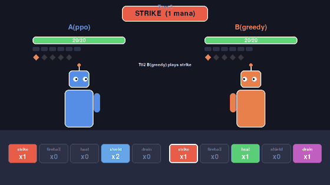
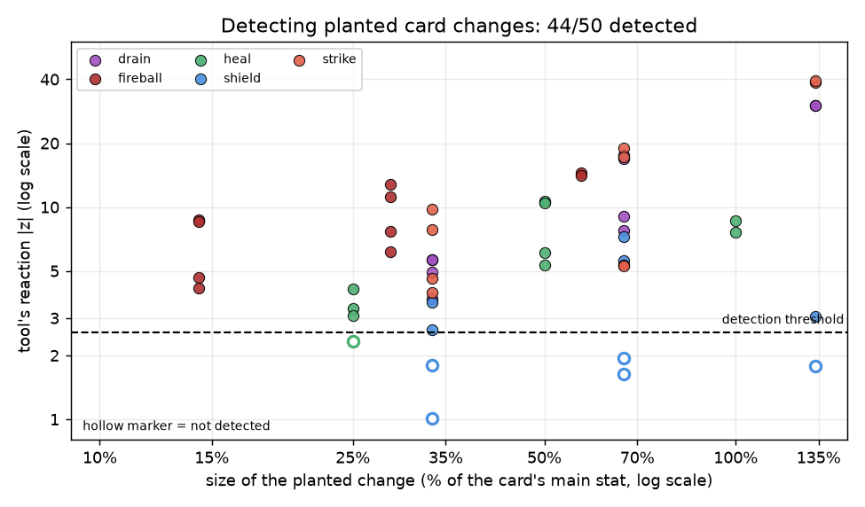

# Card Balance Game

A turn-based card duel, built from scratch, together with the tools to study it: hand-coded bots, reinforcement-learning agents (PPO), and a statistical **balance-testing tool** that estimates which cards are too strong or too weak, and checks its own accuracy by planting known changes.



*A saved game replayed in the built-in viewer: a trained PPO agent (left) beats the greedy bot on turn 21.*

**Status: v0.1, complete.** Engine, bots, tournaments, PPO training (5 seeds), card-power estimator, parameter sweeps, planted-change validation, a first automatic-balancing search, and a graphical replay viewer. Results and their limits are below; some of them are negative.

## The game

Two players start at 20 HP and alternate turns.

- **Mana:** at the start of your own turn it refills to `min(your turn number, 5)`. Unspent mana is lost.
- **Hand:** you start with 3 random cards and draw 1 at the start of each turn (the first player skips the draw on turn 1). The hand limit is 6; extra cards are burned. Draws are random with replacement, weighted by each card's `weight`.
- **On your turn** you may play any number of held, affordable cards, then end the turn.
- **Shield** absorbs damage before HP, is capped at 6, and expires at the start of its owner's next turn.
- You win by reducing the opponent to 0 HP. If both players are alive after turn 40, it is a draw.

| Card | Cost | Effect |
|---|---|---|
| Strike | 1 | Deal 3 damage |
| Fireball | 3 | Deal 7 damage |
| Heal | 2 | Restore 4 HP (max 20) |
| Shield | 1 | Gain 3 shield |
| Drain | 3 | Deal 3 damage and restore 3 HP |

All card stats and rules live in [`configs/cards.yaml`](configs/cards.yaml), so a balance change is a one-line edit. [`configs/cards_balanced.yaml`](configs/cards_balanced.yaml) is the output of the automatic balancing search (see result 4).

## Results

All numbers come from the code in this repo; the raw outputs are in [`docs/results/`](docs/results). Every win rate counts a draw as half a win.

### 1. PPO agents beat all four hand-written bots, consistently across seeds

Five PPO models (seeds 0-4, 600,000 training steps each) were trained against a random mix of the four bots, playing both seats, then all evaluated on the **same fresh games** (500 per bot).

| PPO win rate vs | mean of 5 models | std across models | worst - best |
|---|---|---|---|
| random | 94.4% | 1.0 | 93.0 - 95.5% |
| aggressive | 92.1% | 0.9 | 90.9 - 93.5% |
| defensive | 71.4% | 0.8 | 70.5 - 72.4% |
| greedy | 73.5% | 1.7 | 71.1 - 75.2% |
| **average of the four** | **82.9%** | **0.9** | 81.4 - 83.6% |


Learning is fast (about 73% on average after 50,000 steps) and flattens by roughly 350,000 steps. The standard deviation is across the 5 models. With 500 games per cell, the sampling error of any single cell is about 2 points near 93% and about 4 points near 70% (95% interval), so small differences between cells are noise. Training one model alone takes about 7 minutes on a laptop CPU (the five parallel runs took about 32 minutes in total because they shared the CPU). Full table: [`ppo_five_seeds.txt`](docs/results/ppo_five_seeds.txt).

### 2. Which cards are too strong or too weak?

The estimator uses the random deal as a natural experiment (see [Method](#method)). In 20,000 mirror games of the greedy bot, one extra *starting* copy of each card changes the holder's win probability, relative to the median card, by:


| Card | Effect (points of win probability) | 95% interval | Verdict |
|---|---|---|---|
| Fireball | +9.0 | +8.2 to +9.7 | too strong |
| Drain | +1.9 | +1.2 to +2.7 | ok |
| Heal | 0 (reference) | | ok |
| Strike | -2.2 | -2.9 to -1.4 | too weak |
| Shield | -5.5 | -6.3 to -4.8 | too weak |

With identical hands the first player wins 46.2% (+/- 0.6), so moving second is slightly favourable. A second bot (defensive) gave the same picture. Because each player draws about one card per turn, a card's power is mostly its per-card effect rather than its mana efficiency, which fits Fireball (7 damage) being strong and the 3-point Strike and Shield being weak; this is an interpretation, not something the tool proves.

### 3. Does the tool actually work? Planted-change validation

The game itself is not balanced, so "does the tool flag the card?" would be muddied. Instead the experiment plants known changes (each card's main stat changed by +1, +2, +4, -1 or -2, two independent repeats each) and asks whether the tool sees the card's power change, and attributes it to the right card.



| | Result |
|---|---|
| Planted change detected (correct direction, Bonferroni-corrected) | **44 / 50 (88%, 95% interval 76 - 94%)** |
| ...attributed to the right card (largest change) | 37 / 50 |
| Excluding Shield | detected 39 / 40, attributed 35 / 40 |
| False alarms with nothing planted | 0 / 20 comparisons |

- It sees changes as small as **+14%** (Fireball damage 7 to 8) in both repeats.
- **Shield is where it fails** (detected 5 / 10, attributed 2 / 10): making Shield stronger from 3 to 4, 5 or 7 barely changes win probability (+0.4 to +1.2 points), because shield is capped at 6 and expires each turn. So these misses probably reflect a real lack of effect, not only a blind spot of the tool, but this experiment cannot tell the two apart.
- 0 false alarms in 20 repeats is consistent with a correct 5% error rate (the chance of seeing 0 of 20 at 5% is about 36%), but 20 repeats are too few to show the test is well calibrated.
- Limits: one bot (greedy), two repeats per change, whole-number stat steps, and the smallest change tested was 14%, so the detection floor for subtler changes is unknown.

Raw trials: [`validation_greedy.csv`](docs/results/validation_greedy.csv).

### 4. Can it fix the balance automatically? Only partly

`autobalance` tries single and paired changes to flagged cards, rejects changes that make draws more common, and re-checks the winner on new games with a different bot. On the current game:

- It accepted one change: **Fireball damage 7 to 6 and Strike damage 3 to 4**. Fireball's edge fell from +8.7 to +4.4 points, and on new games with the defensive bot it measured +3.8, so the improvement holds up.
- It **did not balance the game**: 3 cards were still flagged afterwards, Shield was now about -9 points, and draws rose slightly (22.4% to 24.4%).
- The search stopped because every change that strengthens Shield makes games stall into draws, which it forbids. That is a real trade-off in this ruleset, and it matches result 3 (Shield changes barely help).

Details: [`autobalance_greedy.txt`](docs/results/autobalance_greedy.txt).

### 5. Tuning a rule with `sweep`: compensating the second player

Giving the second player extra starting cards, 2,000 mirror games per setting:

| Second player's extra cards | Greedy: first mover wins | Defensive: first mover wins |
|---|---|---|
| +1 | 34.5% | 32.2% |
| 0 (shipped) | 41.4% | 42.8% |
| -1 | 59.0% | 60.4% |

No whole-card setting reaches 50%; the shipped value of 0 is the closest. Games between smart bots are also often stalled: 11.7% of all games in an earlier 7,500-game tournament were draws, concentrated where both sides heal and shield.

### 6. Other findings about the bots

- **Pure aggression is a bad strategy.** The aggressive bot plays only damage cards, so Heal and Shield cards pile up in its hand until the hand limit burns new damage cards. Its Elo is below random.
- **Deterministic bots give fake precision.** In the first, deterministic version of the game, 1,000 games between two heuristic bots were really two distinct games repeated. Random draws, seat-swapped game pairs and shared deal seeds fixed this.

## Run it

Requires Python 3.10+. On Windows PowerShell:

```powershell
python -m venv .venv
.\.venv\Scripts\python.exe -m pip install torch --index-url https://download.pytorch.org/whl/cpu
.\.venv\Scripts\python.exe -m pip install -r requirements.txt
.\.venv\Scripts\python.exe -m pip install -e .
.\.venv\Scripts\python.exe -m pytest -q
```

(`torch` is only needed for training and the PPO tests, which skip without it.)

```powershell
# play and watch games
python -m manaduel.cli watch --a greedy --b defensive --seed 8 --save
python -m manaduel.cli view replays/greedy_vs_defensive_seed8.json          # window
python -m manaduel.cli view replays/greedy_vs_defensive_seed8.json --gif demo.gif

# bots and tournaments (win-rate matrix, intervals, Elo, first-player advantage)
python -m manaduel.cli tournament --n 1000

# train PPO and test it
python -m manaduel.rl.train --steps 600000 --eval-every 50000 --eval-games 200 --seed 0 --out checkpoints/ppo_seed0 --log runs/progress_seed0.csv
python -m manaduel.cli multiseed "checkpoints/ppo_seed*.zip" --n 500 --seed 777
python -m manaduel.cli tournament --n 500 --ppo checkpoints/ppo_seed0.zip

# balance tools
python -m manaduel.cli effects --bot greedy --n 20000
python -m manaduel.cli sweep --set rules.max_shield=3,4,5,6 --bots greedy defensive --n 2000
python -m manaduel.cli validate --bot greedy --reps 2 --null-reps 20
python -m manaduel.cli autobalance --bot greedy --n 10000 --out configs/cards_balanced.yaml
python -m manaduel.cli --config configs/cards_balanced.yaml effects --bot greedy

# figures from saved data
python -m manaduel.cli figures --curves "runs/progress_seed*.csv" --validation docs/results/validation_greedy.csv --effects-bot greedy
```

Use `.\.venv\Scripts\python.exe` in place of `python` if the environment is not activated. The viewer keys are Space (pause), Left/Right (step), Up/Down (speed), R (restart), Q (quit). Trained models and replays are not committed; train your own with the commands above.

## Method

**Card power without bias.** "Win rate when a card is played" is biased: strong players play strong cards when already winning. Starting hands, however, are random and independent of play. For every game, `card_effects.py` regresses the outcome of seat 0 (win = 1, draw = 0.5, loss = 0) on the difference in starting copies of each card between the two seats, plus a seat intercept, in mirror matches (the same bot in both seats). The coefficient of a card is the change in win probability from one extra starting copy. Standard errors are heteroskedasticity-robust (HC1), and a card is flagged only if it is significant after a Bonferroni correction over all cards **and** at least 2 points in size. Effects are only identified relative to each other, so they are reported against the median card (a single outlier does not drag the reference, which the mean would).

**Validation** compares each card's measured power in a changed game against the baseline game on independent deals, using the mean card as the reference (that reference moves linearly, which keeps attribution clean).

## How it is built

```
configs/cards.yaml        card stats and rules (cards_balanced.yaml = autobalance output)
src/manaduel/
  engine/                 state, rules (legal actions, step), game loop
  agents/                 Agent interface, random + heuristic bots, PPO wrapper
  sim/                    tournaments, Wilson intervals, Elo, JSON replays
  rl/                     observation encoding, Gymnasium env, PPO training
  analysis/               card effects, sweep, validate, autobalance, multi-seed, plots
  viewer/                 text viewer and pygame replay viewer (PNG / GIF export)
tests/                    109 tests
docs/                     figures, demo GIF, raw results
```

- **The game is a pure function.** `step(state, action)` returns a new state and never modifies the old one. The random-number state lives inside the game state, so any game replays exactly from its seed.
- **One `Agent` interface** (`act(state, legal_actions, config)`) makes random, heuristic and learned bots interchangeable.
- **Action masking.** `MaskablePPO` gives illegal moves zero probability; the environment raises an error on an illegal action, so a masking bug cannot hide.
- **Sparse reward:** +1 win, -1 loss, 0 draw, nothing otherwise.
- **PPO is index-based**, so a trained model goes stale when card stats change. The balance tools therefore screen with the heuristic bots, which read card stats from the config.

## Limitations

- Everything is simulated, and balance for bots is not balance for humans.
- The estimator measures the value of holding a card at the **start** of the game (together with how the tested bot uses it), not every effect over a whole game.
- Validation used one bot, two repeats per change and changes of at least 14%; the detection floor for smaller changes is unknown, and Shield changes could not be detected at all.
- PPO was trained and tested against four simple, fixed bots. It was not tested against strong human play or against itself (no self-play), so beating these bots does not mean near-optimal play.
- Wilson intervals assume independent games; paired deal seeds make them slightly optimistic.
- `autobalance` is a greedy search over whole-number steps tuned with the greedy bot and verified with only one other bot. It reduced the largest imbalance but did not produce a balanced game.
- The model sees only the size of the opponent's hand, not its cards.
- No license has been granted yet; all rights are reserved by default.

## Roadmap

- [x] Game engine, bots, tournaments, replays
- [x] PPO agents, five seeds
- [x] Card-power estimator, sweep, planted-change validation, autobalance search
- [x] Graphical replay viewer
- [ ] Self-play training
- [ ] Finer card changes (non-integer stats, per-seat modifications) so balancing is not limited to whole-number steps
- [ ] Validation with more bots, more repeats and smaller planted changes
- [ ] MCTS baseline (non-trivial because of hidden hands)
