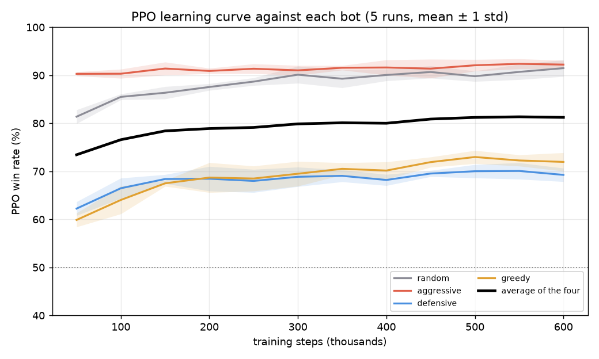
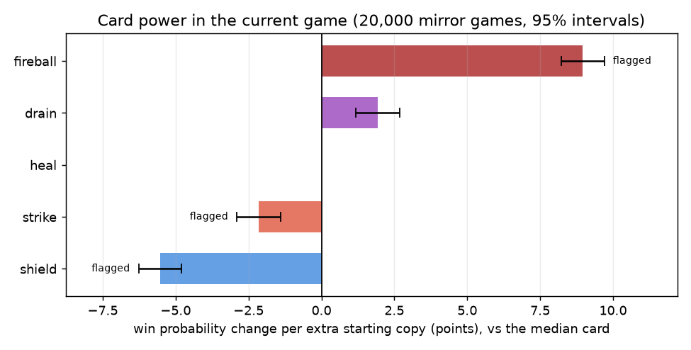
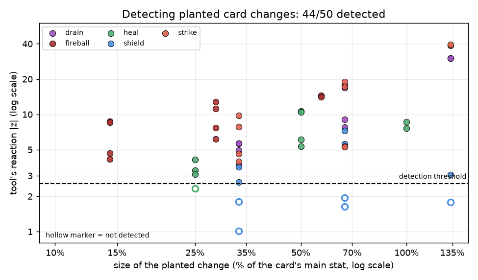
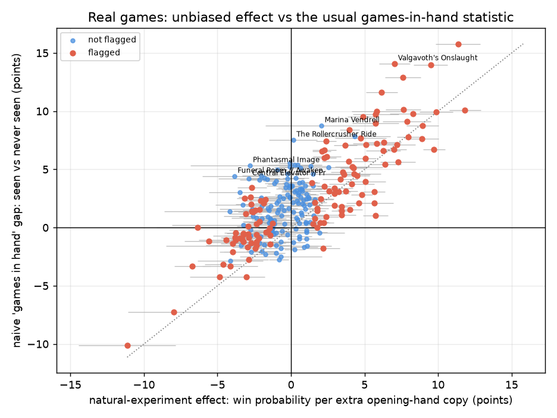
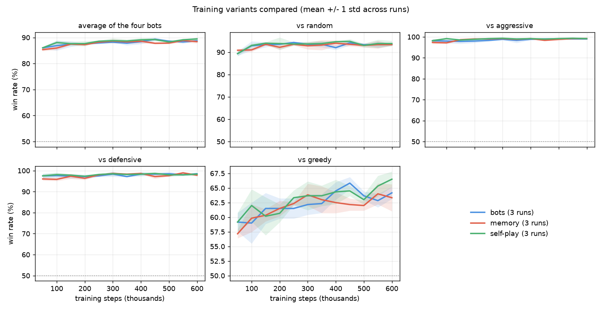
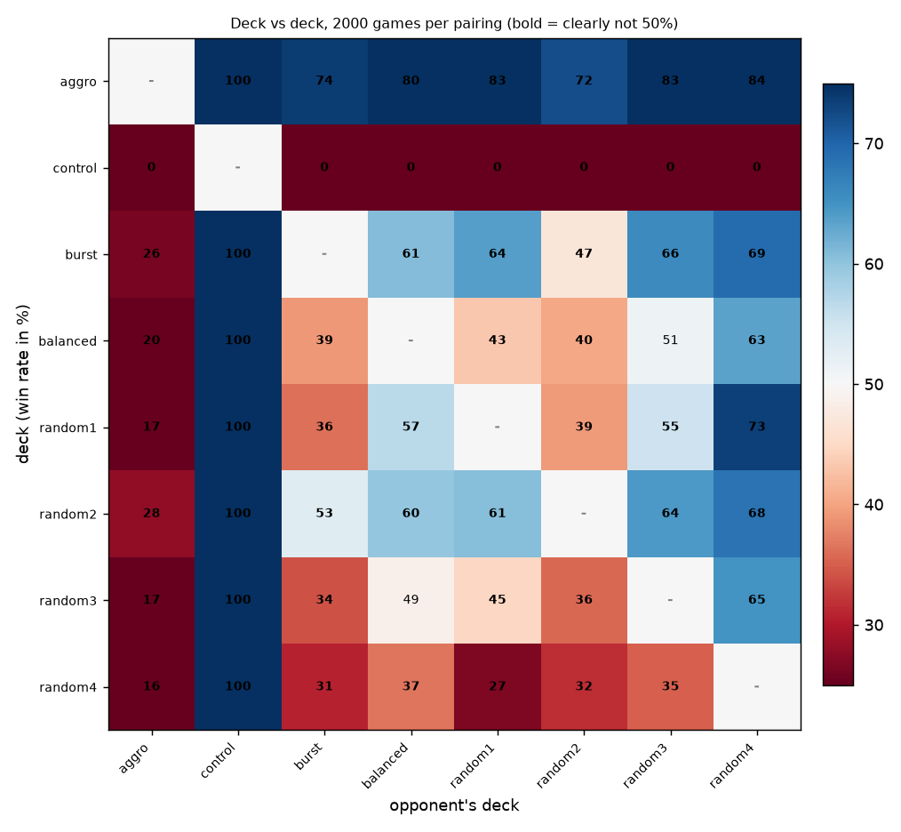
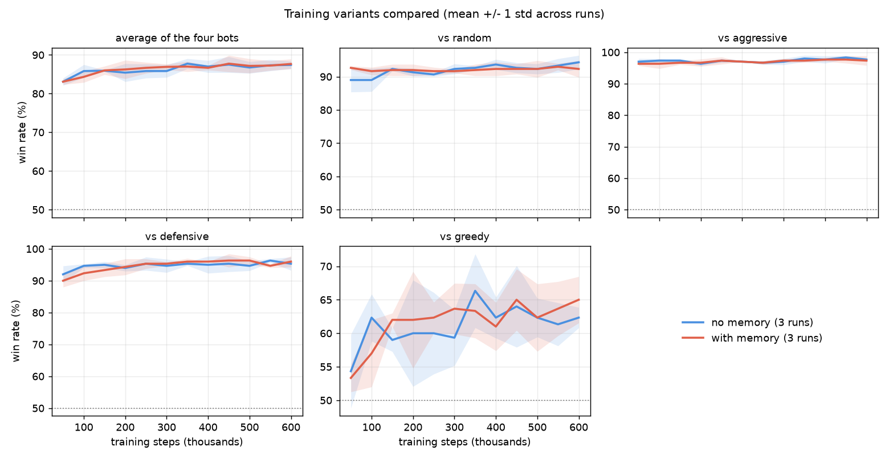

# All experiments in detail

This is the long version of the project: every experiment, with its numbers, its files and its caveats. The short version
is the [README](../README.md). Result numbers in the README refer to the numbered results below. A draw counts as half a win.

## The results

All numbers come from the code in this repo; raw outputs are in [`docs/results/`](results). A draw counts as half a win. "Std" is the spread across independently trained models, not across games.

### 1. PPO beats all four hand-written bots (original game, 5 seeds)

Five PPO models (600,000 steps each) evaluated on the same fresh games, 500 per bot:

| PPO win rate vs | mean of 5 models | std |
|---|---|---|
| random | 94.4% | 1.0 |
| aggressive | 92.1% | 0.9 |
| defensive | 71.4% | 0.8 |
| greedy | 73.5% | 1.7 |

### 2. Which cards are too strong or too weak? (original game)

The estimator uses the random deal as a natural experiment (see [Method](#method)). In 20,000 mirror games of the greedy bot, one extra *starting* copy of each card changes win probability, relative to the median card, by: **Fireball +9.0, Drain +1.9, Strike −2.2, Shield −5.5** (95% intervals about ±0.8).

**Is that just how the bots play?** No: the same measurement using the trained PPO agents (8,000 games each, three models, [files](results/effects_ppo_base_seed0.txt)) gives Fireball +8.5 to +9.6, Strike −0.8 to −1.8, Shield −3.6 to −5.2. Learned agents trained to win agree with the bots, so Shield's weakness looks like a property of the cards. (The first player's win rate with identical hands came out at 52.3%, 52.9% and 42.8% for the three models: that quantity is sensitive to the agent.)

### 3. Does the tool work? Planted-change validation

Known changes were planted on each card (+1, +2, +4, −1, −2 on its main stat, two repeats) and the tool asked to find them:

| | Result |
|---|---|
| Planted change detected | **44 / 50 (88%, 95% interval 76-94%)** |
| ...attributed to the right card | 37 / 50 |
| Excluding Shield | detected 39 / 40 |
| False alarms with nothing planted | 0 / 20 comparisons |

It sees changes as small as +14%. **Shield is where it fails** (5 / 10): making Shield stronger barely changes win probability, which is consistent with result 2 (a real property of the card, not only a blind spot). Limits: one bot, two repeats, smallest change tested 14%.

### 4. A real game: the same idea on 17Lands Magic: The Gathering data

The estimator was adapted to **896,877 real no-mulligan games** (set DSK, Premier Draft, 266 cards; data from [17Lands](https://www.17lands.com/public_datasets), CC BY 4.0, not included in this repo). Players choose their decks, but the opening hand is a random draw from the deck, so what is random is how many *more* copies of a card landed in the opening hand than the deck predicts. The effect is the change in win probability per extra opening-hand copy, relative to a basic land. Standard errors use a jackknife over groups of drafts.

| Check | Result |
|---|---|
| Replication: two random halves of the drafts | correlation of the two halves' effects **0.92**; 129 cards clearly non-zero in both halves, **all 129 with the same sign** |
| Sanity: on-the-play effect from the regression | **+5.1** points vs **+5.0** raw play/draw difference in the data |
| Cards flagged (Bonferroni, at least 1 point) | 73 strong, 51 weak of 266 |
| Strongest / weakest card | Zimone, All-Questioning +11.8 [10.7, 12.9]; Dazzling Theater // Prop Room −11.1 [−14.4, −7.8] |
| Agreement with the "games in hand" style statistic (seen vs never seen) | correlation 0.77 (rank 0.66), same sign for 68% of cards |

For the 69 cards whose effect is under 1 point, the "seen" statistic still shows a median gap of **+2.3 points**, an offset that fits the idea that longer games draw more cards and winners play longer games. **But the two statistics measure different things** (a card in the opening hand versus a card seen at any time, which values late-game cards differently), so their disagreement is not proof that either is wrong.

Honest framing: 17Lands already publishes opening-hand and games-in-hand statistics, so this is a **replication of known measures** with a careful uncertainty estimate and a replication test, not a new discovery. It has no ground truth for "true" card strength, effects hold for the kind of player who put the card in a deck, and it is one set. It does not test the bot-based results above on humans.

### 5. Automatic balancing, second attempt: better, still not balanced

v0.1's search only moved stats by whole numbers and gave up quickly. v0.2's `tune` command works on a doubled-resolution copy of the same game (a test checks it plays identically), can change every effect, every cost and three rules, searches coarse-to-fine, and minimises a combined objective (card power spread, excess draw rate, first-player advantage) averaged over two bots. It tested 314 configurations and made 9 changes. Checked on **new** deals (20,000 games per bot):

| | Draws | First player wins* | Cards flagged |
|---|---|---|---|
| Greedy bot, before | 22.3% | 46.1% | Strike −2.4, Fireball +8.2, Shield −6.0 |
| Greedy bot, after | 11.3% | 48.1% | Strike +3.6, Drain +2.9, Shield −6.1 |
| Defensive bot, before | 28.1% | 46.3% | Strike −3.0, Fireball +8.2, Shield −6.1 |
| Defensive bot, after | 15.3% | 48.6% | Strike +4.8, Heal −2.5, Shield −5.8 |

\*with identical hands. **What improved:** draws roughly halved, the first-player edge shrank, and Fireball stopped being an outlier. **What did not:** the number of flagged cards stayed at three; Strike overshot, and **Shield stayed at about −6**. The search never fixed Shield: it raised Shield's effect only from 6 to 7 (doubled units) and, strangely, made it *more* expensive (cost 1 to 3), because those moves helped the draw-rate and first-player terms of the objective, which Shield's own power did not outweigh. The search both tuned and was checked with the same two bots (on new deals).

**Independent check with learned agents.** Three PPO models were trained on the tuned game (600,000 steps each) and card power measured with them (8,000 mirror games each, [files](results/effects_ppo_balanced_seed0.txt)): **Strike +4.2 to +5.3 and Drain +4.7 to +5.3 (too strong), Shield −5.6 to −8.0 (too weak), flagged in all three models**; Heal is fine. The first player's win rate with identical hands is **48.0%, 50.3%, 49.1%**, close to fair. So with learned agents too, the first-player edge is fixed but the card imbalance is not (and Shield looks slightly worse than with the bots).

Details: [`tune_greedy_defensive.txt`](results/tune_greedy_defensive.txt); resulting config [`cards_fine_balanced.yaml`](../configs/cards_fine_balanced.yaml) (numbers are in doubled units, so HP is 40).

### 6. New mechanics, opponent memory and self-play (extended card set)

Nine PPO models: three seeds each of **bots-only** (the v0.1 recipe), **+ opponent-card memory** (the agent also sees how many copies of each card the opponent has played), and **+ self-play** (a frozen copy of the agent is added to the opponent pool after every evaluation, the last four are kept). 600,000 steps each; evaluated on the same fresh games (500 per bot) and then model against model (400 games per pairing of two models).

| Win rate vs | random | aggressive | defensive | greedy | mean |
|---|---|---|---|---|---|
| bots-only (3 models) | 94.5% | 98.1% | 96.5% | 64.3% | 88.4% |
| + memory | 94.1% | 97.8% | 96.2% | 63.8% | 88.0% |
| + self-play | 95.5% | 98.0% | 96.5% | 65.0% | 88.8% |

| Model against model (9 pairings of 3 vs 3 models) | Row model wins | Std across pairs | Row model ahead in |
|---|---|---|---|
| bots-only vs bots-only, other seeds (**control**) | 50.0% | 1.6 | 3 of 9 |
| with memory vs bots-only | 48.2% | 1.0 | 0 of 9 |
| self-play vs bots-only | 51.2% | 1.8 | 6 of 9 |
| self-play vs with memory | 53.4% | 2.2 | 9 of 9 |

How to read it, honestly:
- **Memory did not help**, and was slightly worse head to head (48.2%, behind in all 9 pairings, while the control varies by about ±1.6). With three models per group this is suggestive, not proof. A plausible reason (not tested): with endless random draws, the opponent's played cards say little about their hand, and the extra inputs may only slow learning. In deck mode, where played cards narrow down the remaining deck, memory could matter; it was trained there too (result 9) and made no difference either.
- **Self-play's advantage (51.2% vs the 50.0% control) is smaller than the seed-to-seed spread**, so it is not established. It beat the memory models in all 9 pairings, but those models also carry memory's penalty.
- Against the hardest bot (greedy) the agents win only about 64%, down from 73% in the original game, while crushing the other three: the new cards are not balanced against each other (result 7).

### 7. Deck building and the metagame (deck mode, greedy bot)

Eight decks (four archetypes plus four random ones), 2,000 games per pairing:

- **The metagame is degenerate:** the *aggro* deck beats the average other deck 82.3% of the time; the equilibrium mix puts 100% on it; there are **no** rock-paper-scissors cycles; the *control* deck (heals, shields, no real damage) loses every single game.
- **Card power in deck context** (random decks given to both players, a second natural experiment): per extra copy in a 20-card deck Venom is **+6.1**, Fireball +3.9, Flurry +2.6, Shield −2.9; per extra copy in the *opening hand* Venom is **+15.5**. The two measures correlate 0.86. Venom is by far the strongest card; the new set was not tuned.
- **Deck builder** (hill climbing from the balanced deck against the 8-deck field, 300 games per matchup): average win rate against the field went from 49.6% to **75.2%** on new games, but the field included decks it was built against, and aggro still beats the built deck 56.2% of the time. This shows the metagame is easy to exploit, not that the builder is a strong deck designer.

Details: [`metagame_decks.txt`](results/metagame_decks.txt).

### 8. A search baseline: Monte Carlo tree search with a hidden opponent hand

A learned agent is more convincing next to a search player that uses no training at all. [`agents/mcts.py`](../src/manaduel/agents/mcts.py) is an *information-set* tree search: the opponent's hand is hidden, so every search iteration first **guesses** the opponent's hand (random cards, the true hand *size*, drawn by the cards' draw weights) and re-randomises the future card draws, so the search cannot peek at the real hand or at the game's random-number state. A test checks exactly that: swapping the opponent's hand for a different hand of the same size does not change its move. It then plays the game out with a rollout policy and passes the result up the tree (an opponent's node picks the move that is best for the opponent).

How strong it is grows with search effort (the original game; 100 games per cell, so about ±10 points; [file](results/mcts_effort.txt)):

| Iterations per move | rollouts: random bot vs MCTS: random / greedy | rollouts: greedy bot vs MCTS: random / greedy |
|---|---|---|
| 25 | 86.5% / 56.0% | 81.5% / 49.0% |
| 100 | 86.0% / 60.5% | 90.5% / 64.0% |
| 400 | 91.5% / 66.5% | 94.0% / 70.5% |

With 200 iterations and greedy rollouts ([file](results/mcts_headline.txt), 100 games each): **91.5%** against random, **84.0%** against aggressive, **67.0%** against defensive and **67.5%** against greedy. Against the five PPO agents from result 1 it wins **45.4%** of 500 games (47.5, 44.5, 39.5, 50.0, 45.5), 41.1% to 49.8% as a 95% interval. PPO is slightly stronger than a 200-iteration search (PPO beats greedy and defensive about 73% and 71% of the time), by a margin that is just at the edge of what 500 games can show, and it answers in milliseconds while the search needs seconds per game. More iterations were still improving the search when this was run, so this is not a ceiling for MCTS.

Limits: it supports the endless-draw game only (in deck mode the opponent's deck is also hidden, which is not modelled, so it refuses); the guess for the opponent's hand ignores what they have played; rollouts are a rough model of how both players act.

### 9. Deck mode: does opponent-card memory matter there?

Result 6 found that memory did not help with endless random draws and suggested it might in deck mode, where cards played narrow down what is left. It was trained and tested: three models **with** memory and three **without**, on the 20-card deck game ([`cards_decks.yaml`](../configs/cards_decks.yaml)), 600,000 steps each. Each game gives both players one of four archetype decks; evaluation spreads games evenly over all 16 deck pairings.

| Win rate vs (all deck pairings) | random | aggressive | defensive | greedy | mean |
|---|---|---|---|---|---|
| no memory (3 models) | 79.5% | 79.5% | 78.8% | 59.0% | 74.2% |
| with memory (3 models) | 79.4% | 79.4% | 78.8% | 58.7% | 74.1% |

| Model against model (9 pairings of 3 vs 3 models, about 380 games each) | Row model wins | Std across pairs |
|---|---|---|
| memory vs no memory | **50.7%** (ahead in 5 of 9) | 1.2 |
| no memory vs no memory (control) | 50.5% | 1.2 |
| memory vs memory (control) | 49.9% | 1.2 |

**Memory made no detectable difference in deck mode either** (50.7% against a control that wanders by about ±1.2). The agents were not shown which deck the opponent brought, so memory could in principle have helped by narrowing it down; either that did not matter for these four decks, or the networks did not learn to use it in 600,000 steps. Neither explanation was tested. Raw files: [`deck_*_final.txt`](results/deck_nomem_final.txt), [`deck_h2h_*.txt`](results/deck_h2h_memory.txt), [curves](results/deck_mem_curve_seed0.csv) (the curves use the balanced deck for both players).

### 10. Balancing the extended card set: balanced for bots is not balanced for agents

The tools were applied to the extended set ([`cards_extended.yaml`](../configs/cards_extended.yaml): the original five cards plus Insight, Venom, Flurry), in two stages.

**Stage 1, search with bots** (`tune` on a doubled-resolution copy, [`cards_extended_fine.yaml`](../configs/cards_extended_fine.yaml); greedy and cautious bots, 409 configurations, 8 moves, [log](results/tune_extended.txt)). For those bots it worked: the spread of card power (RMS of the effects) fell from 6.2 to 1.9 points with the greedy bot and the first-player edge went from 56.7% to 47.5%. The result is [`cards_extended_balanced.yaml`](../configs/cards_extended_balanced.yaml). But three trained PPO agents on this "balanced" set find **Flurry at +20 points**: the bots hardly use the combo bonus, so the search kept raising it, while a learned agent learns to exploit it. The search had fitted the bots' weaknesses.

**Stage 2, correction with agents in the loop** ([`agent_rounds.py`](../src/manaduel/analysis/agent_rounds.py)). Each round trains 3 PPO agents (600,000 steps) on the current set, measures every card with them (8,000 mirror games each), and nudges each card that the agents agree is at least 3 points off, in a damped way (effect numbers scaled by 1 - effect/25 points, at most 40% per round; a card that only draws gets its cost changed). Four rounds, selected by the smallest spread: round 3, [`cards_extended_agent_balanced.yaml`](../configs/cards_extended_agent_balanced.yaml) ([rounds](results/agent_balance_rounds.txt)).

| Round (agent-measured) | 0 (bot-tuned) | 1 | 2 | 3 (chosen) | 4 |
|---|---|---|---|---|---|
| Spread of card power (RMS, points) | 7.6 | 4.3 | 3.9 | **3.6** | 4.3 |
| Worst card | Flurry +20.5 | Flurry +9.4 | Shield −7.5 | Shield −9.3 | Shield −10.9 |

**Final check on new deals** (seed 424242, not used in any tuning step; [file](results/ext_tuning_final.txt)). Mean of three agents per version; the last two columns use the bots instead:

| Version of the extended set | Agents: spread (RMS) | Agents: worst card | Agents: cards 3+ points off | Agents: first player wins | Greedy bot: spread / first player |
|---|---|---|---|---|---|
| original | 6.8 | Venom +12.9 | 5 | 56.6% | 6.2 / 56.7% |
| tuned with bots | 7.6 | Flurry +20.4 | 2 | 56.9% | **1.9 / 47.5%** |
| tuned with agents | **3.6** | Shield −9.3 | **1** | **47.8%** | 4.7 / 44.1% |

What this shows, and what it does not:
- **Balance is relative to who plays.** The version the bots find balanced is the one the agents find worst; the version tuned with agents looks unbalanced to the bots (Flurry −8 points, first player 44%). A balance claim needs the kind of player it is about.
- **Agent-tuning helped, but did not finish the job.** With agents the spread halved against the original (6.8 to 3.6) and four of the five off-balance cards were brought within 3 points. **Shield stays too weak**: its numbers were raised every round (14, 17, 22, 30 in doubled units) and its measured effect did not improve (−6.0, −7.5, −9.3, −10.9). Other cards changed in the same rounds, and effects are measured against the median card, so this is not a clean experiment, but it agrees with results 2, 3 and 5: Shield's power barely depends on its size.
- The first-player edge dropped from 56.9% to 47.8% for the agents although nothing targeted it; the cause was not isolated (Insight's cost went up in round 1, which may matter).
- Rounds were chosen on the same deals they were measured on, which favours the chosen round slightly; the new-deal check above shows the same spread (3.6), so the selection effect looks small. Three agents per version is a small sample, and the rule is a damped heuristic, not an optimiser.
- Shield stayed too weak in this stage; result 12 explains why and fixes it with a rule change.

### 11. Checking against human players: the tool exists, the data does not

Everything above is bots and learned agents. [`play`](../README.md#run-it) lets a person play the game in the terminal and, since this version, logs the cards both sides were dealt. The deal is random whoever plays, so the same card-power regression works on human games. `humancheck` runs it on the log and prints the human effects next to the bot effects, says whether the bot effect lies inside the human interval, and says how many games would be needed for a given precision. It refuses to fit with fewer than 5 games per card and warns when the intervals are too wide to see anything.

**No such analysis has been done**: no human games have been logged. From the bot-based numbers (a standard error of about 0.5 points at 20,000 games) a precision of about ±2 points per card needs on the order of 5,000 human games (about 1,250 for ±4), a rough estimate. So this roadmap item is built but **not completed**, and the claim "balanced for humans" cannot be made. The tool is tested on synthetic logs with a planted effect (it recovers it); that is a test of the code, not evidence about people.

### 12. Fixing Shield: it needed a rule change, not a bigger number

**Why Shield was weak.** Shield expires at the start of its owner's next turn, so it can only absorb damage during the single enemy turn it lasts. [`scripts/shield_diagnosis.py`](../scripts/shield_diagnosis.py) counts, in 300 mirror games of trained agents, how much of the shield they gain actually absorbs damage:

| Card set | Shield cards played per game | Shield points gained | Points that absorbed damage | HP absorbed per Shield card |
|---|---|---|---|---|
| original game | 5.3 | 4,755 | 591 (**12%**) | 0.37 |
| extended set after result 10 | 3.5 | 23,166 | 838 (**4%**) | 0.79 |

What a Shield can absorb is limited by the damage the opponent deals in that one turn, not by the number on the card, which is why raising it round after round (result 10) did nothing.

**The fix: a new rule.** `shield_keep_percent` (default 0, the original rule, so every earlier result is unchanged: the 200-game regression still passes) says how much shield is still there at the start of its owner's next turn; 100 keeps it until enemy damage uses it up (the cap `max_shield` still applies). Both variants started from the result-10 set with Shield reset to its original size and went through the same agent-in-the-loop rounds:
- **50%**: Shield stayed at −9.6 and −9.4 points; stopped after two rounds. Not enough.
- **100%**: Shield was at −4.0 on the first measurement and within 3 points after one correction round. [`cards_extended_final.yaml`](../configs/cards_extended_final.yaml) is round 1 ([all rounds](results/shield/shield100_rounds.txt)). Later rounds did not improve it: the worst card moved around (Fireball +5.4, Venom +5.5, then −5.6) because Venom's poison counter can only jump from 3 to 4 (a third bigger), and with three agents the measurements are noisy.

**Check on new deals** (seed 777777, not used in any tuning step; mean of 3 trained agents per version, 8,000 mirror games each; [file](results/ext_final_four_versions.txt)):

| Version of the extended set | Spread of card power (RMS, points) | Shield | Worst card | Cards 3+ points off | First player wins |
|---|---|---|---|---|---|
| original | 6.8 | −10.8 | Venom +13.1 | 4 | 56.7% |
| tuned with bots (result 10) | 7.6 | −2.5 | Flurry +20.5 | 2 | 57.0% |
| tuned with agents (result 10) | 3.7 | −9.3 | Shield −9.3 | 1 | 47.8% |
| **final (Shield persists)** | **1.8** | **−0.2** | Insight +3.4 | 1 | 46.1% |

**Limits.** A persistent shield is a different card (armour rather than a one-turn guard), so this is a change to the game, not only to numbers. The final set is balanced for these learned agents; the hand-written bots again disagree (they see Flurry −5.5, Insight +5.3, Venom +4.7 and a first-player rate of 43%). The first-player edge is now reversed (the second player wins about 54%); nothing targeted it and the integer levers for it are coarse. Three agents per version is small, and the round was chosen on the same deals it was measured on (the new-deal check shows the same 1.8).

**The deck metagame, redone on the final set** ([`cards_decks_final.yaml`](../configs/cards_decks_final.yaml), greedy bot, same eight-deck method as result 7; [file](results/metagame_decks_final.txt)):

| | Result 7 (original extended cards) | With the final set |
|---|---|---|
| Best deck's average win rate against the others | 82.3% (aggro) | 62.5% (random1; aggro 57.6%) |
| Equilibrium mix | 100% on one deck | 3 of 8 decks (78.5%, 18.6%, 2.5%) |
| Rock-paper-scissors cycles | none | 2 |
| Control deck (heals, shields) | loses every game | still loses almost every game (7.6% average) |

The card fixes made the metagame healthier, but the deck builder still finds an exploit: hill climbing from the balanced deck ends at **6 Heal + 6 Venom** (poison that ignores shields, plus healing) and wins 83.2% against the field on new games, after which the equilibrium puts 99.9% on it. This was only tested against the greedy bot. Also, in deck mode the two card-power measures disagree (correlation −0.27): Insight is +7.0 per opening-hand copy but −5.6 per deck copy, which may be because drawing cards uses up a 20-card deck faster and fatigue starts earlier (a guess, not tested). So the final set is balanced for endless-draw play, **not for deck play**, which would need its own agent-in-the-loop rounds in deck mode.

### 13. Deck mode: three attempts to balance it, none fully works

Result 12 left deck mode unbalanced. Three attempts, all on the final card set ([`cards_decks_final.yaml`](../configs/cards_decks_final.yaml)):

**(a) Agent-in-the-loop rounds in deck mode.** [`agent_rounds.py`](../src/manaduel/analysis/agent_rounds.py) now handles decks: agents are trained on the four archetype decks plus 12 random ones, card power is the effect of one more copy *in the deck* (agent mirror games with random decks), and every round one agent plays an eight-deck round robin ([files](results/deck_balance/rounds_stopped_after_round2.txt)). I stopped it after three of six planned rounds because nothing was improving:

| Round | Spread of per-copy card power (RMS, points) | Worst card | Best deck's average win rate against the other seven | Decks in the equilibrium |
|---|---|---|---|---|
| 0 (the set from result 12) | 2.6 | Insight −5.9 | 70.4% (aggro) | 1 of 8 |
| 1 | 2.9 | Insight −6.0 | 73.8% (random4) | 2 of 8 |
| 2 | 2.4 | Insight −5.3 | 73.7% (random4) | 1 of 8 |

- **Insight stays 5 to 6 points weaker per deck copy** than the median card even after its cost went from 3 to 2 to 1, so its problem is not its price. A plausible cause, not tested: drawing from a 20-card deck brings fatigue closer.
- **The per-card rule oscillates at this resolution:** Fireball went from +3.2 to −2.4 after a 36% cut, and Venom's poison counter was cut from 3 to 2 and then the next correction proposed 3 again.
- **The metagame did not move:** the aggro deck beats six of the other seven decks (by up to 87%), and the best deck wins 70 to 74% against the others in every round. So balancing cards one at a time does not balance decks: the problem is combinations of cards, which a per-card average cannot see.
- A difference between players: against the greedy bot the control deck (heals, shields) loses nearly every game (result 12), but for the trained agent it is a playable deck (39% average against the others).

**(b) A limit on copies per card.** A new rule, `deck_max_copies` (default 0: no rule, the tools assume 6), with [`cards_decks_final_cap4.yaml`](../configs/cards_decks_final_cap4.yaml) and [`cards_decks_final_cap3.yaml`](../configs/cards_decks_final_cap3.yaml). Same method as result 12 (greedy bot, 2,000 games per pairing; [limit 4](results/metagame_decks_final_cap4.txt), [limit 3](results/metagame_decks_final_cap3.txt)), plus the same round robin played by one trained agent ([file](results/deck_cap_agent_check.txt)):

| Copy limit | Control deck, average win rate (greedy bot) | Decks in the equilibrium (greedy bot) | Deck builder's deck against the field, on new games (greedy bot) | Best deck against the others (trained agent) |
|---|---|---|---|---|
| none (up to 6) | 7.6% | 3 of 8 | 83.2% (6 Heal + 6 Venom) | 70.4% |
| 4 | 29.0% | 4 of 8 | 79.0% (a Heal, Shield, Drain deck) | 66.4% |
| 3 | 41.4% | 2 of 8 | 73.0% | 63.9% |

A limit helps somewhat: the control deck becomes playable, the Heal + Venom deck disappears, and the best deck's edge shrinks. But decks become more alike: with a limit of 4 or 3 the aggro and burst archetypes turn into the *same* deck, so there are fewer real choices. The deck builder still finds a deck that beats every deck in the field; any search against a fixed field will, so that alone does not show the game is broken.

**(c) What is still missing.** A better health measure would repeatedly add the best response to the current equilibrium and count how many decks survive (a "double oracle" loop), with trained agents as the players. That is expensive and was not done.

**Result:** deck mode is **not** balanced. The endless-draw game is balanced for the trained agents (result 12); for deck play, a copy limit of 3 or 4 reduces the problem but trades away variety.

### 14. Can the agent be made stronger? Longer training did nothing; a bigger network helped a little

The agents win about 83% of their games against the four bots. Is that limit set by the training? Three variants were trained on the original game, two models each, for 2.4 million steps (four times the usual 600,000), then tested on 500 fresh games per bot and played against the five baseline models (10 pairings, 400 games each):

| Variant | vs random | vs aggressive | vs defensive | vs greedy | mean | against the baseline models |
|---|---|---|---|---|---|---|
| baseline: 5 models, 600,000 steps, network 128 x 128 | 94.4% | 92.1% | 71.4% | 73.5% | 82.9% | |
| longer: same settings, 2.4M steps | 94.3% | 91.7% | 71.4% | 74.6% | 83.0% | 50.2% (ahead in 6 of 10 pairs) |
| bigger: 2.4M steps, network 256 x 256, 512 steps per update, batch 512 | 96.3% | 92.8% | 72.4% | 74.9% | **84.1%** | **55.5%** (ahead in 10 of 10) |
| bigger, less exploration: 256 x 256, exploration bonus 0.003 | 94.9% | 92.6% | 71.0% | 73.5% | 83.0% | 52.9% (ahead in 8 of 10) |

([longer](docs/results/strong_long_final.txt), [bigger](docs/results/strong_big_final.txt), [bigger, less exploration](docs/results/strong_bigcalm_final.txt), [head to head](docs/results/strong_big_vs_baseline.txt), [curves](docs/results/strong_big_curve_seed0.csv).)

- **Longer training alone did nothing.** The learning curves are flat after about 600,000 steps, and the longer models are no better than the baseline (50.2% head to head).
- **A bigger network with larger batches helped a little.** It gained about 1 point against the bots and beat the old models 55.5% of the time, ahead in all 10 pairings. Three settings changed together, and only two models were trained, so I cannot say which setting mattered or that the size of the gain is exact.
- **There is probably a ceiling set by luck.** Against defensive and greedy even the baseline models lose about 20% of their games and draw 11 to 17% ([file](docs/results/ppo_win_draw_loss.txt)); hands are random, so some games are lost whatever the play. This is a suggestion, not a proof: the tree search with four times more search also stopped near 70% against greedy (result 8).

### 15. Other findings

- **Pure aggression is a bad strategy.** The aggressive bot plays only damage cards, so heals and shields clog its hand until the hand limit burns new damage cards. Its Elo is below random.
- **Deterministic bots give fake precision.** In the first, deterministic version, 1,000 games between heuristic bots were really two distinct games repeated. Random draws, seat-swapped game pairs and shared deal seeds fixed this.
- **First-player advantage had to be tuned** with the `sweep` command: giving the second player an extra card gave the first mover 32-35%, none gave 41-43%, one fewer gave 59-60%.

## Method

**Card power without bias.** "Win rate when a card is played" is biased: strong players play strong cards when already winning. Starting hands, however, are random and independent of play. For every game, `card_effects.py` regresses the outcome of seat 0 (win = 1, draw = 0.5, loss = 0) on the difference in starting copies of each card between the two seats, plus a seat intercept, in mirror matches. Standard errors are heteroskedasticity-robust (HC1); a card is flagged only if it is significant after a Bonferroni correction **and** at least 2 points in size. Effects are identified only relative to each other, so they are reported against the median card (one outlier does not drag it, unlike the mean).

**Real data** (`real_data.py`): the same idea where decks are chosen: the regressor is copies in the opening hand minus copies in the deck times 7 / deck size; games with a mulligan are dropped; standard errors by delete-one-group jackknife over groups of drafts.

**Card power in deck context** (`metagame.py`): random decks for both players, regress the result on the difference in deck composition.

**Validation** compares each card's measured power in a changed game against the baseline game on independent deals.

**Balance search** (`balance_search.py`): coarse-to-fine steepest descent on J = mean(card power in points)² + draw penalty + first-player penalty, all candidates on the same seeds.

**Metagame**: deck-vs-deck matrix; the equilibrium mix comes from multiplicative weights; exploitability = how much the best single deck beats a mix.
